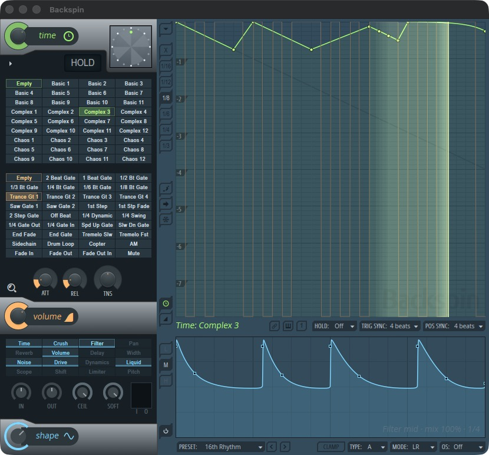

<div align="center">

# Backspin

**Gross Beat, rebuilt in Rust. Time and volume gating with shapers, as CLAP and VST3.**



</div>

Backspin is a Rust port of Image-Line Gross Beat, built on
[nih-plug](https://github.com/robbert-vdh/nih-plug). The same input, state and parameters give
the same output as the original, sample for sample (5,086 parity renders,
[report](PORT_REPORT.md)). Under the Gross Beat form sits a shape section with per-band
shapers and Clamp, a clipper at the end of the chain.

## Install

Download the latest installer from the [releases](https://github.com/figtracer/backspin/releases):

- **macOS (Apple Silicon):** open `Backspin-<version>-arm64.pkg`. It is not notarized, so
  right-click it and choose Open.
- **Windows (x64):** run `Backspin-<version>-windows-x64-setup.exe`. It is not signed, so
  SmartScreen may ask (More info, Run anyway). Needs a CPU with FMA.

Rescan plugins in your DAW and add Backspin to an audio track.

## Build

```sh
cargo xtask bundle backspin --release
```

The bundles land in `target/bundled`. `scripts/package.sh` builds the macOS installer, and
`cargo run --release -p backspin --features standalone --bin backspin-standalone -- --backend dummy`
opens the editor without a host.

## License

[GPL-3.0-or-later](LICENSE). Not affiliated with Image-Line. Gross Beat and FL Studio are
trademarks of Image-Line.
